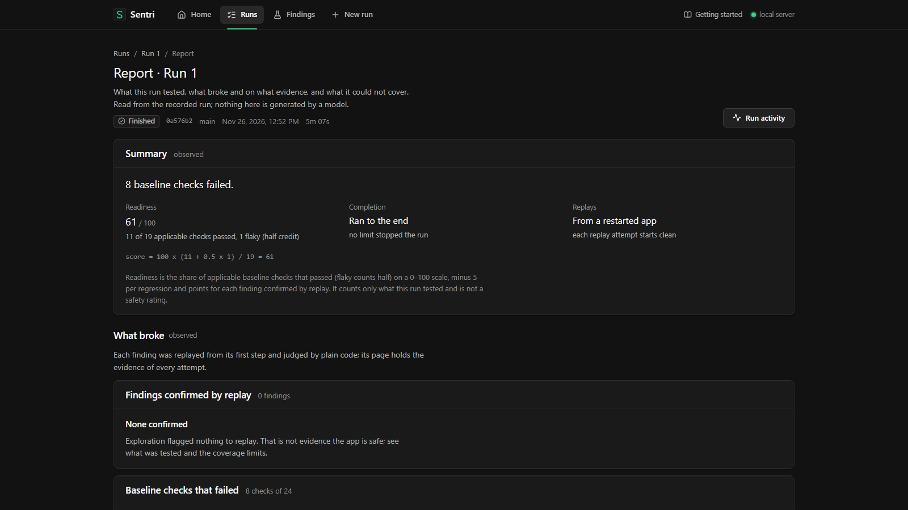
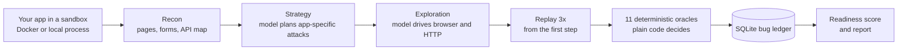
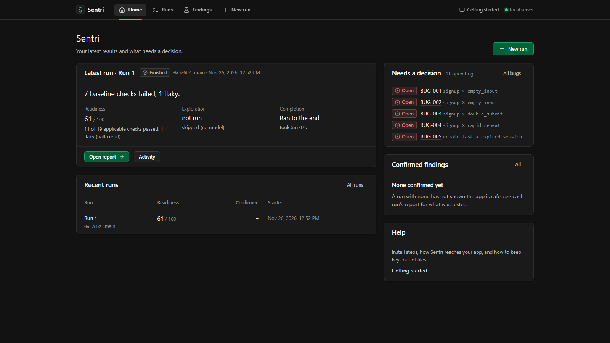

<a id="readme-top"></a>

<div align="center">

# Sentri

**Sentri is an agent that attacks a running web app like a hostile user, so it breaks in testing and not in a live demo.**<br>
The AI plans the attacks; plain code decides pass or fail from measured evidence.

[](https://github.com/Barathkumar-17/SENTRI/actions/workflows/ci.yml)
[](LICENSE)
[](https://www.python.org/downloads/)
[](https://fastapi.tiangolo.com)
[](https://react.dev)
[](https://www.typescriptlang.org)
[](https://vite.dev)
[![Playwright](https://img.shields.io/badge/Playwright-Chromium-2EAD33?logo=)](https://playwright.dev)
[](https://sqlite.org)
[](https://www.docker.com)



**[Quickstart](#quickstart)** &nbsp;·&nbsp; **[How it works](#how-it-works)** &nbsp;·&nbsp; **[Documentation](documentation/README.md)**

<sub>The screenshot shows a real run on the bundled demo app (<code>examples/buggy-app</code>) and the bugs planted in it; see <a href="#demo">Demo</a>.</sub>

</div>

> Scope: verified on the included demo apps (`examples/buggy-app` and the `examples/flow-shop` shop) and two short
> proof runs; this is not a general reliability claim. See [Testing and limits](#testing-and-limits).

> [!TIP]
> Reviewing this project? Start with [Problem and solution](#problem-and-solution), then [Demo](#demo), then [Testing and limits](#testing-and-limits).

## Contents

**What you get** &nbsp;·&nbsp; [Highlights](#highlights) · [Features](#features) · [Tech stack](#tech-stack)

**Run it** &nbsp;·&nbsp; [Quickstart](#quickstart) · [Configuration](#configuration)

**Under the hood** &nbsp;·&nbsp; [How it works](#how-it-works) · [Key design principle](#key-design-principle-the-model-proposes-code-decides) · [Project layout](#project-layout)

**For reviewers** &nbsp;·&nbsp; [Problem and solution](#problem-and-solution) · [Demo](#demo) · [Testing and limits](#testing-and-limits) · [Team](#team)

**About** &nbsp;·&nbsp; [Roadmap](#roadmap) · [Documentation](#documentation) · [Acknowledgements](#acknowledgements) · [License](#license)

## Highlights

| | |
| --- | --- |
| **Docker sandbox** | Runs the app in a throwaway container, reset between attempts and published on the host's `127.0.0.1` only; without Docker the app runs as a local process. |
| **11 deterministic oracles** | Plain-code checks judge every replay: HTTP 5xx, stack traces, console errors, duplicates, hangs, logged-out access, cross-user exposure, XSS, missing CSRF checks, replay and race duplicates, and state corruption. |
| **3x replay of every finding** | Each suspected break is replayed three times from the first step of the session; 3 of 3 is fail, 1 or 2 of 3 is flaky. |
| **Bug ledger across commits** | Confirmed bugs go into a SQLite ledger that is re-checked on later runs, so regressions are flagged. |
| **Provider-swappable model** | Claude Code, Codex CLI, Gemini CLI, the Anthropic API, any OpenAI-compatible API or Ollama, or no model at all. |
| **Local dashboard** | `sentri ui` starts runs, follows them live and shows reports and replay evidence, listening on localhost only. |

## Features

- **Agentic exploration** with recon, an app-specific strategy and step-by-step browser and HTTP actions.
- **Replay confirmation**: a suspicion only becomes a bug after plain code sees it reproduce.
- **Two test identities** (`a`, `b`) to check logged-out access and cross-user data exposure.
- **Code-owned checks**: Sentri marks what each test user writes and opens their records as the other user and
  logged out, independent of the model.
- **Baseline suite** of six fixed attacks and a readiness score comparable across commits.
- **Bug ledger** across commits, with regressions flagged and human decisions recorded (`sentri bug mark`).
- **Bring your own model, or none**: Claude Code, Codex CLI, Gemini CLI, Anthropic API, any OpenAI-compatible
  API, or Ollama. Per-run token, call, step, time and budget limits.
- **Local web app** (`sentri ui`) to start runs, follow them live, read reports and inspect replay evidence. It
  listens on localhost only.
- **GitHub Action** that comments the score and regressions on pull requests, with optional merge gates.
- **Optional fixer** (`sentri fix`) for baseline crash bugs with a stack trace: it proposes a patch, runs a fixed
  gate and opens a draft pull request only if the gate passes.
- **Safety by default**: browser traffic is fenced to the app's origin, and API keys and provider account ids
  are scrubbed from the ledger, evidence, reports, logs and the web app.

## Tech stack

| Area | Used |
|---|---|
| Engine and CLI | Python 3.12+, Typer, Pydantic, Rich |
| Browser automation | Playwright (Chromium) |
| Sandbox | Docker SDK for Python, or a local process |
| Ledger | SQLite |
| Local server and API | FastAPI, Uvicorn |
| Web app | React, TypeScript, Vite (built into the package, no Node needed to use it) |
| Models | Anthropic SDK, OpenAI-compatible HTTP via httpx, Claude Code / Codex / Gemini CLIs, Ollama |
| Quality | pytest, Ruff, mypy (strict on the verdict package), GitHub Actions |

## Quickstart

Requires Python 3.12 or newer. Docker is optional. No API key is needed for this quickstart.

```bash
git clone https://github.com/Barathkumar-17/SENTRI.git && cd SENTRI
pip install -e ".[dev]"
sentri setup        # downloads the Chromium build Playwright drives
sentri doctor       # checks Python, Chromium, Docker, git and model settings
```

`sentri doctor` prints one row per check (trimmed here); Docker and the LLM are optional:

```text
│ Python    │ ok       │ 3.13.18 on Linux x86_64                 │
│ Chromium  │ ok       │ Chromium 158.0.8127.36                  │
│ Docker    │ optional │ daemon not reachable ...                │
│ Local DNS │ ok       │ reverse lookup of 127.0.0.1 in 0.00s    │
│ git       │ ok       │ found                                   │
│ LLM       │ optional │ none (static payloads); optional: ...   │
```

Run it against the bundled demo app, which has planted bugs. Approving a contract is a deliberate human step:

```bash
sentri contract approve examples/buggy-app/contract.yaml --as "Your Name" --out examples/buggy-app/approved.yaml
```

```text
approved by Your Name at 2026-11-25T20:20:56Z -> examples/buggy-app/approved.yaml
```

Then run the baseline suite (no model needed):

```bash
sentri run --contract examples/buggy-app/approved.yaml --out report.md
```

It runs 24 checks (4 flows x 6 attacks), each 3 times from a restarted app; this took about 4 minutes on a Linux
test machine. The end of the output:

```text
signup:empty_input: FAIL - POST /api/signup -> 500 [3/3]; ...
signup:double_submit: FAIL - list_selector: 2 created, expected 1 [3/3]
...
comment:empty_input: FLAKY - ...
...
run 1 finished: readiness 61
model: 0 calls, 0 input + 0 output tokens, $0.0000
report written to report.md
readiness: 61   score = 100 x (11 + 0.5 x 1) / 19 = 61
```

The result: 7 failing checks, 1 flaky, 11 passing and 5 not applicable, 13 bugs in the ledger. This matches the
demo app's planted bugs in [`expected_grid.yaml`](examples/buggy-app/expected_grid.yaml) cell for cell.

Open `report.md`, or list the bugs with `sentri bug list`. To let a model explore, add a provider, for example
`--llm-provider claude_code` (a signed-in Claude Code) or `--ollama qwen2.5:7b` (a local model). See
[getting started](documentation/getting-started.md) for Docker mode and your own app.

## Configuration

**A model is optional.** With none, Sentri runs the baseline suite with built-in payloads; it needs no account
and no key. `sentri models` lists the model sources on your machine, and `--llm-provider auto` picks a signed-in
CLI or a local server, never a paid API key on its own.

| Setting | Flag | Environment variable |
|---|---|---|
| Provider | `--llm-provider` (`auto`, `claude_code`, `codex`, `gemini_cli`, `anthropic`, `openai_compatible`) or `--ollama MODEL` | `SENTRI_LLM_PROVIDER` |
| Endpoint for OpenAI-compatible APIs | `--llm-base-url` | `SENTRI_LLM_BASE_URL` |
| API key | (environment only) | `ANTHROPIC_API_KEY`, `SENTRI_LLM_API_KEY` |
| Model | `--model`, `--model-smart` (fixer) | `SENTRI_MODEL_FAST`, `SENTRI_MODEL_SMART` |
| Paid-API budget per run | | `SENTRI_LLM_BUDGET_USD` (default 1.00) |
| Exploration limits | | `SENTRI_EXPLORE_STEPS` (default 60), `SENTRI_EXPLORE_MINUTES` (default 10) |
| Ledger location | `--db` | `SENTRI_DB` |

Keys are read from the environment only, never from a file Sentri ships. What Sentri tests is described in a
`contract.yaml` (flows, how to start the app, which attacks to run); see [the contract](documentation/contract.md)
and [models](documentation/models.md).

Exit codes: 0 finished, 1 gate failed (`--fail-under`, `--fail-on-regression`), 2 contract or config error, 3 app
failed to start, 4 infrastructure missing.

## How it works



1. **Sandbox.** Sentri starts your app in a throwaway Docker container, or as a local process when Docker is not
   available, and resets it between attempts.
2. **Recon (code only).** It crawls every reachable page, form and link, logged out and as a signed-in test
   user, reads the OpenAPI spec when there is one, and maps which pages and endpoints need login.
3. **Strategy (model).** A model reads that map and plans attacks for *this* app. Hypotheses that do not point
   at real pages or endpoints are dropped.
4. **Exploration (model proposes).** The model drives a real browser and raw HTTP requests step by step and
   picks each next move from what happened.
5. **Replay 3x.** Every suspected break is replayed three times from the first step of the session, each from a
   restarted app (an app you only give as a URL is replayed on its live state, and the report says so).
6. **11 deterministic oracles** judge each replay: HTTP 5xx, stack traces in responses, browser console errors,
   duplicate records, hangs, logged-out access to protected data, one user seeing another's data, unescaped
   reflected input (XSS), state changes accepted without their CSRF token, duplicates from replays or races,
   and state corruption. A finding is **fail** at 3 of 3, **flaky** at 1 or 2 of 3.
7. **Ledger and score.** Confirmed bugs go into a SQLite ledger that is re-checked on later runs, so regressions
   are flagged. A fixed baseline suite of six attacks gives a **readiness score** that stays comparable across
   commits.

With no model configured, Sentri skips steps 2 to 4 and runs only the baseline suite (empty input, double
submit, expired session, slow network, bad file, rapid repeat).

Details: [how Sentri works](documentation/how-it-works.md).

## Key design principle: the model proposes, code decides

The model can suggest attacks and drive the browser, but it never decides a verdict. The verdict, ledger and
report code may not import any model, attacker, planner or fixer code, and the replay and confirmation path may
not reach it through any chain of imports. This is enforced by a test,
[`tests/test_trust_boundary.py`](tests/test_trust_boundary.py), which runs with the normal test suite. Only a
human can mark a bug as intended.

Sentri also tests as a **black box**: the model sees the running app's pages, requests and responses, never its
source code, README, database or server logs. App content reaches the model only as fenced, untrusted data.

## Project layout

```text
src/sentri/
  agent/        recon, strategy, exploration and replay confirmation
  attacks/      the six baseline attacks
  verdict/      deterministic oracles, verdict engine and readiness score (no model code)
  ledger/       SQLite bug ledger
  report/       markdown report
  sandbox/      Docker and local-process sandboxes
  llm/          model providers
  dashboard/    FastAPI server and the built web app
  fixer/        optional patch proposer and gate
  cli.py        the `sentri` command
frontend/       web app source (React, Vite, TypeScript)
examples/       demo apps with planted bugs, CI example, saved proof runs
documentation/  user and developer guides
tests/          unit, verdict, integration and trust-boundary tests
action.yml      the GitHub Action
```

## Problem and solution

| Problem | Solution |
|---|---|
| Web apps break in front of users or in a live demo because nobody tested them like a hostile user: an empty form, a second click, a stale tab, a bad file, a slow network, a user opening someone else's record by its id. Hand-written tests only cover the paths you thought of, and an AI agent on its own will happily report bugs that are not there. | Sentri attacks the running app in a disposable sandbox (a Docker container, or a local process when Docker is not available). The AI plans the attacks; plain code decides pass or fail from measured evidence. Every suspected break is replayed 3 times before it reaches the report, and bugs go into a ledger that is re-checked from commit to commit, with a readiness score for each run. |

## Demo

The screenshots are from a real run of the [Quickstart](#quickstart) on the bundled demo app
(`examples/buggy-app`, which has planted bugs), from a fresh clone of `main` at `0a576b2`, with no model:

```bash
git clone https://github.com/Barathkumar-17/SENTRI.git && cd SENTRI
pip install -e ".[dev]"
sentri setup
sentri contract approve examples/buggy-app/contract.yaml --as "Your Name" --out examples/buggy-app/approved.yaml
sentri run --contract examples/buggy-app/approved.yaml --out report.md
sentri ui
```

The run scored **readiness 61** (`score = 100 x (11 + 0.5 x 1) / 19 = 61`): 11 checks passed, 7 failed, 1 was
flaky and 5 did not apply, and it took 5 min 8 s on a Windows 11 machine. For example, submitting the signup form
empty made `POST /api/signup` return HTTP 500 in 3 of 3 replays (BUG-001). It also found a double submit that
creates 2 accounts and a rapid repeat that creates 4, HTTP 500s from `POST /tasks/new` on an expired session, a
bad file and rapid repeats, and an HTTP 500 from `POST /api/comments` on empty input in 1 of 3 replays (flaky).

<p align="center">
  
  <br><sub><b>Run report.</b> The readiness score with its formula, what broke and the evidence behind it.</sub>
</p>

<p align="center">
  
  <br><sub><b>Home.</b> The latest run, recent runs and the open bugs that need a human decision.</sub>
</p>

## Testing and limits

### Run the tests

```bash
pip install -e ".[dev]" && sentri setup
ruff check src tests scripts examples
ruff format --check src tests scripts examples
mypy src                         # strict on the verdict package
pytest                           # fast tests (unit, verdict, trust boundary)
python scripts/smoke_test.py     # the CLI and the web workflow end to end
pytest -m integration            # browser and demo-app tests, including the full baseline grid (minutes)
```

More detail, including the Docker lifecycle check: [development](documentation/development.md).

### What has and has not been verified

Sentri is an early MVP (version 0.1.0, not yet released). What has actually been run:

- **Fixture apps.** The full baseline grid on `examples/buggy-app` is compared cell by cell against
  [`expected_grid.yaml`](examples/buggy-app/expected_grid.yaml) by the integration tests. `examples/flow-shop` is a
  small shop with hidden failures used for agentic validation.
- **One Docker + model run** on flow-shop (Claude Sonnet 5.5 through Claude Code, 15 steps): it confirmed one HTTP
  500, replayed 3 of 3. That contract had no baseline flows, so this run produced no readiness score, and the
  fixer's draft pull request step was not part of it.
- **Two short proof runs** with a real model on OWASP Juice Shop 20.4.0 and flaskr, in command mode; results are in
  the [example report](documentation/example-report.md).
- **The fixer's draft pull request path** has no end-to-end test or recorded run yet.
- These are existence proofs, not detection rates. Sentri has not been shown to work reliably on arbitrary apps.
- **Not covered:** business logic (a wrong total is not a crash), security scanning (no CVE, TLS or header
  checks; use ZAP, Burp or Nuclei), desktop and mobile apps, and phone layouts for the web app.

The full list is in [limitations](documentation/limitations.md). **Only run Sentri on apps you own or have
permission to test.**

## Team

| Member | GitHub |
|---|---|
| Barathkumar | [@Barathkumar-17](https://github.com/Barathkumar-17) |
| Gokul K | [@Gokul-2k7](https://github.com/Gokul-2k7) |

## Roadmap

- Run Sentri on more apps beyond the fixtures and the two proof apps, and publish the reports.
- More model-driven runs in Docker mode (one so far).
- Test small local models for driving exploration (currently untested).
- Tag the first release.

## Documentation

Full documentation: [`documentation/`](documentation/README.md). Report security issues privately as
described in [SECURITY.md](SECURITY.md). Changes are listed in the [changelog](CHANGELOG.md).

## Acknowledgements

- [PentestGPT](https://github.com/GreyDGL/PentestGPT), for showing how an LLM can drive multi-stage testing.
- [MAPTA](https://arxiv.org/abs/2508.20816) (Multi-Agent Penetration Testing AI for the Web), for the idea that
  every finding needs end-to-end validation before it counts.
- [Playwright](https://playwright.dev), which drives the browser.

## License

MIT. See [LICENSE](LICENSE).
