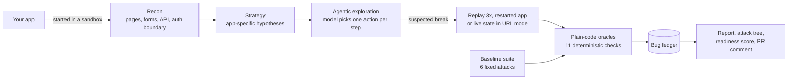

# Sentri documentation

Sentri attacks a running web app like a hostile or careless user, so it breaks in testing and not in front of
an audience. An AI agent explores the app and decides what to try; plain code decides whether anything broke.

| Read this | When you want to |
|---|---|
| [Getting started](getting-started.md) | Install Sentri and run it on the demo app, then on your own app |
| [How Sentri works](how-it-works.md) | Understand the phases, the agent, the verdicts and the trust boundary |
| [The contract](contract.md) | Write or review `contract.yaml`, the human-approved description of your app |
| [Models](models.md) | Choose a model: none, Claude Code, Codex CLI, Gemini CLI, Ollama, or an API key |
| [Verdicts, bugs and the score](verdicts-and-ledger.md) | Read results: the oracles, flaky vs fail, the bug ledger, regressions, the readiness score |
| [Command line](cli.md) | Every command, option, environment variable and exit code |
| [Local web app and API](web-app.md) | The web app's screens, the API behind them, and how it stays safe and leaks nothing |
| [CI with GitHub Actions](ci.md) | Run Sentri on every pull request with your own model settings |
| [Fixer](fixer.md) | Let Sentri propose a fix as a draft pull request behind a plain-code gate |
| [Development](development.md) | Repository layout, tests, the demo app, and how to contribute |
| [Limitations](limitations.md) | What Sentri does not catch, and known rough edges |
| [Example report](example-report.md) | Real runs against open-source apps: findings, time and cost |

## In one picture

The model sits only on the left of "Replay": it plans and acts. Everything from replay onwards is plain code
(a test follows the imports of the replay and oracle code to prove it never reaches model code), so the same
evidence always gives the same verdict. No model means no agent: only the baseline suite runs.

**Only run Sentri on apps you own or have permission to test.**
